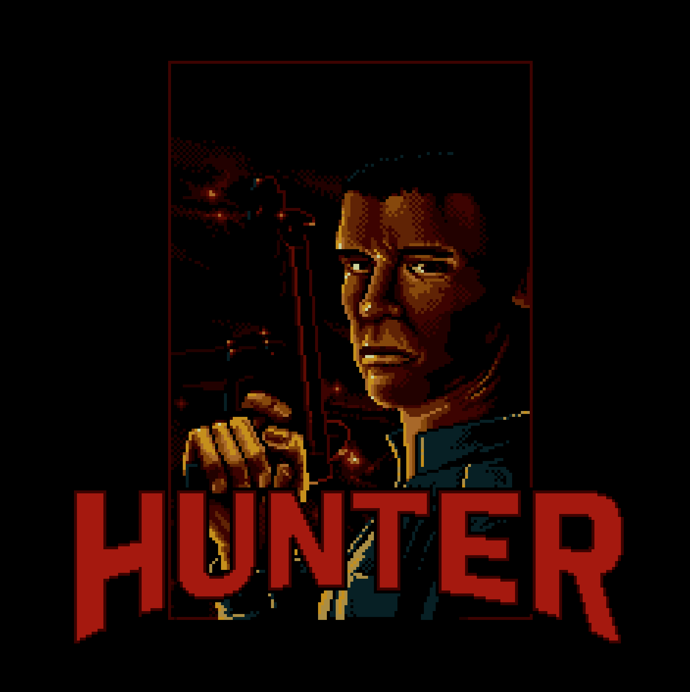
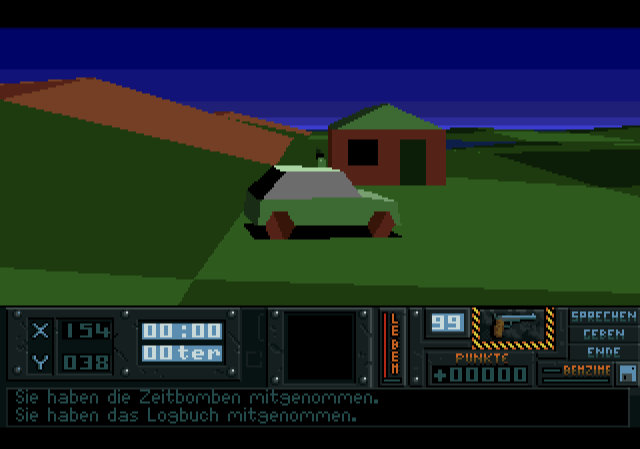
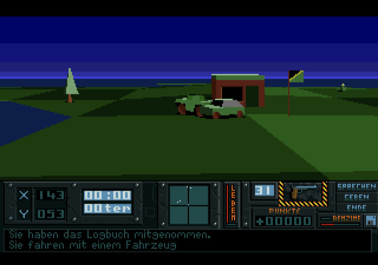
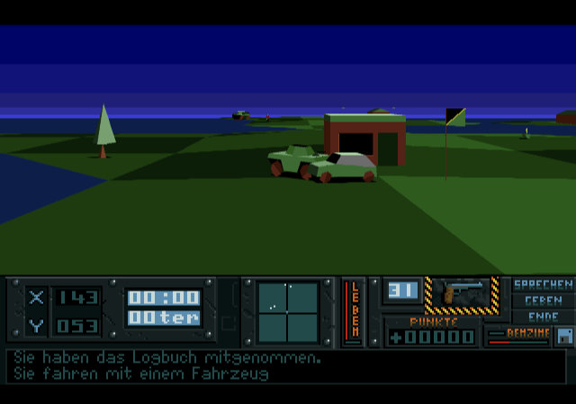

# Hunter RTG

**Classic Amiga game with RTG support and other improvements**

## Status

Currently, the following features have been implemented:

1. Graphics card instead of Amiga chipset: The game runs via Picasso96 on RTG cards. I tested it on my Warp1260.
2. System-friendly: It launches from the hard drive / Workbench. The operating system continues to run, and you can exit the game by selecting “Quit Hunter” without having to reboot. Game saves can be stored directly to the hard drive.
3. Higher resolution: The landscape is rendered at 640x480 instead of the original, lower-resolution version. However, 320x240 will remain as an option.
4. Significantly faster: The program and buffers reside in Fast-RAM, and the processor handles the rendering instead of the blitter.
5. Larger view distance: Normal, Far, and Very Far levels. The horizon scales accordingly, and distant objects are also rendered.
6. Anti-aliasing: The edges of the 3D polygons are smoothed.
7. Settings menu: Screen resolution 640×480 or 320×240, draw distance, objects, anti-aliasing, FPS display. Settings are saved in settings.ini.

## Lowres

## Highres, Anti-aliasing & larger view distance

## Triggerwarning

I used Claude code to implement this.

## Installation

The game currently supports only the German version. The English version is in the works. All you need is “Disk.1” from the German WHDLoad package. The installer will take care of the rest.
Download the [installer](build/Hunter-Installer.zip 'ZIP document').

## Bugs & hugs

The game creates a log file. Feel free to send it to me. I also welcome feedback, bug reports, and ideas.
